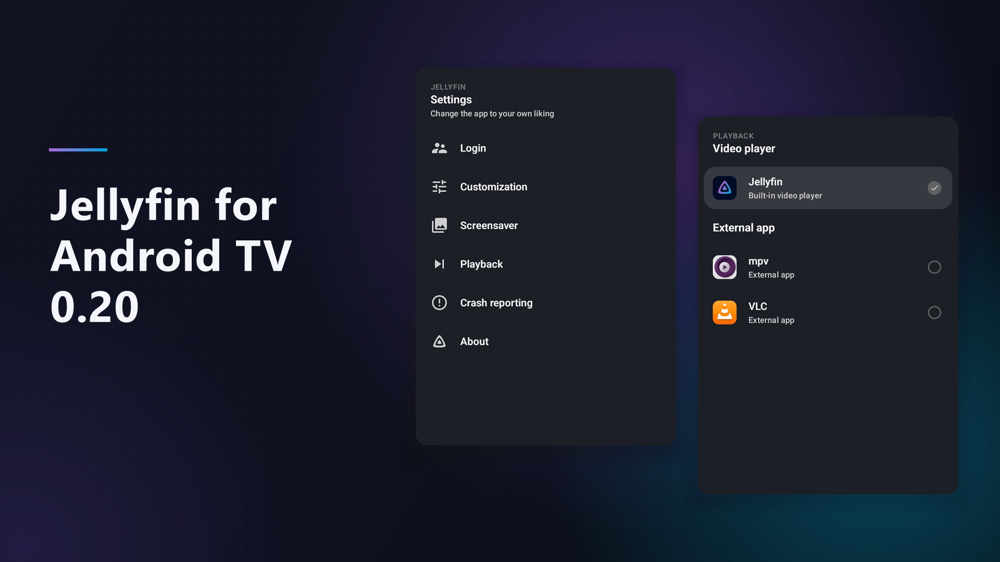
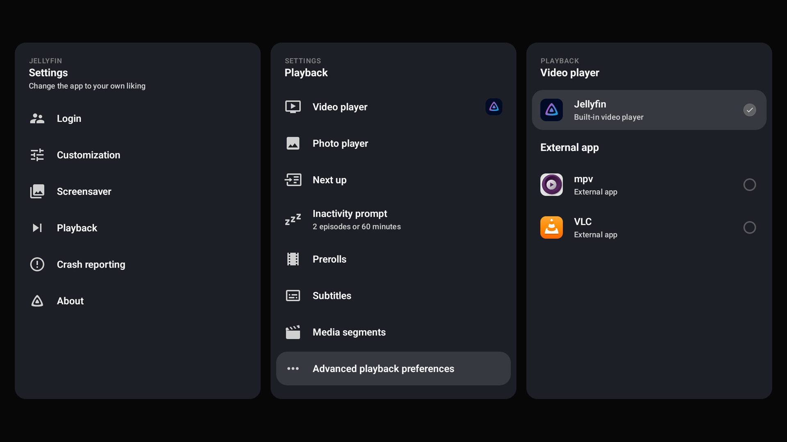

{/* cspell:ignore androidtv Vimu */}

We're excited to announce a brand new release of **Jellyfin for Android TV**, version 0.20! This update comes with redesigned settings,
support for more subtitle formats, better external playback and much more.

{/* truncate */}

This post will highlight some of the most notable changes. A complete list is available in the
[GitHub changelog](https://github.com/jellyfin/jellyfin-androidtv/releases/tag/v0.20.0).

## Redesigned settings

The settings within the app got a facelift! The options are easier to find, with more ways to customize the app. Some options
previously hidden in the developer settings are now available in the regular playback settings too. The sections below cover a few of
these changes.

## Video playback

The app detects your device's playback capabilities more accurately, helping more videos play without transcoding. If the app doesn't
detect your setup correctly, you can override support for HDR formats and audio passthrough codecs, as well as adjust the H.264 and
H.265 codec level limits in the playback settings.

While browsing, you'll see badges for HDR and surround audio formats, as well as 3D content. TrickPlay support is no longer experimental:
you'll see thumbnail previews when seeking through videos that have TrickPlay images available.

## External video players

You can now choose which video player to use in the app's settings, whether that's Jellyfin's built-in player or a compatible third-party
player you've installed on your device. The app has special handling for VLC, MPV, MX Player and Vimu to pass along external subtitles and
read your playback position when you return to Jellyfin.

Other compatible players can also be used, but won't report playback progress back to Jellyfin.

## Subtitles

  

Direct playback of Advanced SubStation Alpha (ASS) and SubStation Alpha (SSA) subtitles is now supported. This uses libass to render
subtitles directly on your device, avoiding the need to transcode video just to display them. Support is still experimental and can be
enabled in the advanced playback settings. It's disabled by default for now, but we're aiming to enable it for everyone in a future release.

As part of the redesigned settings, subtitle customization offers custom colors and more font weights.
A new preview shows your changes as you make them, so you can get subtitles looking just the way you want.

A new option lets you always burn in subtitles when a video needs transcoding. This can help with subtitles getting out of sync in
certain scenarios, but the customization settings will be lost.

And finally, if you change the subtitle language during playback, the app will remember your choice for the next episode when a matching
subtitle track is available.

  

  

    
  

## Browsing and home screen

You can choose how many days a show stays in the Next Up row after you last watched it. You'll find this option in the home screen
settings, helping keep the row focused on shows you're actively watching.

When browsing your TV library, you can sort shows by the date their latest episode was added. Additionally, works listed on a person's
page are sorted by release date, with the newest first.

Jellyfin 12 introduced changes to how the Recently Added row works. The app handles these changes correctly, displaying the right titles
and images. New navigation buttons make it easier to move between a series and its seasons.

The app can show recommendations on your Android TV home screen. Some Android versions no longer let you disable this integration through
system settings, so you can turn it off directly in the app. This setting only shows up on supported devices.

## Music and photos

The music library has a new "Shuffle all" button alongside the existing random song button.

The photo viewer lets you go to the next or previous photo in an album using the left and right buttons
on your remote. No need to open the controls first! And if you'd rather sit back and enjoy your photos without lifting a finger, you can
adjust the slideshow speed to give yourself more (or less!) time to enjoy each one.

## Compatibility

**Jellyfin Server 10.11 or newer is required**, and the app works best with Jellyfin 12. Jellyfin 10.10 is no longer supported, so please
update your server before updating the app if you're still using it.

The minimum Android version has also been raised to **Android 6**. Version 0.19.x is the last release series compatible with Android 5 and
5.1. We plan to require Android 7 or newer in an upcoming release as platform requirements change.

## Fire TV

Some users have noticed that our app isn't available on newer Fire TV devices. Amazon has introduced a new operating system called Vega OS,
which can't run Android apps. A Jellyfin app for Vega OS is in development, and we hope to share more soon!

Jellyfin for Android TV will continue to be available on Fire TV devices running the Android-based Fire OS.

## Made possible by you

Jellyfin is completely developed by volunteers, and couldn't be made without their great skills and dedication. Consider donating if you
appreciate their work. A big shout-out to all contributors that made this release possible:

**Jellyfin Team**

- [@nielsvanvelzen](https://github.com/nielsvanvelzen) - Donate via [Buy Me a Coffee](https://buymeacoffee.com/nielsvanvelzen) or
  [GitHub sponsors](https://github.com/sponsors/nielsvanvelzen)

**Other contributors**

{/* cspell:disable */}

- [@johnpc](https://github.com/johnpc)
- [@RealGreenDragon](https://github.com/RealGreenDragon)
- [@BlackstormFirst](https://github.com/BlackstormFirst)
- [@GertSallaerts](https://github.com/GertSallaerts)
- [@Syquel](https://github.com/Syquel)
- [@tal\-sarid](https://github.com/tal-sarid)
- [@flip\-dots](https://github.com/flip-dots)
- [@hwneh](https://github.com/hwneh)
- [@akhilmulpurii](https://github.com/akhilmulpurii)
- [@luca\-schlecker](https://github.com/luca-schlecker)
- [@TheMejmun](https://github.com/TheMejmun)
- [@JagerSprinkles](https://github.com/JagerSprinkles)
- [@skalthoff](https://github.com/skalthoff)
- [@galaterro](https://github.com/galaterro)
- [@WizardOfYendor1](https://github.com/WizardOfYendor1)
- [@bin101](https://github.com/bin101)
- [@GeiserX](https://github.com/GeiserX)
- [@LTe](https://github.com/LTe)
- [@dieselw0w](https://github.com/dieselw0w)
- [@ps\-kl](https://github.com/ps-kl)
- [@854562](https://github.com/854562)
- [@Mehvix](https://github.com/Mehvix)
- [@vladski\-i](https://github.com/vladski-i)
- [@DerrickDW](https://github.com/DerrickDW)
- [@Charlie284](https://github.com/Charlie284)
- [@hraabis](https://github.com/hraabis)
- [@clowncracker](https://github.com/clowncracker)
- [@leonida92](https://github.com/leonida92)
- [@andrew749](https://github.com/andrew749)
- [@mvletter](https://github.com/mvletter)
- [@HaraldNordgren](https://github.com/HaraldNordgren)
- [@Meloakartas](https://github.com/Meloakartas)
- [@sebv004](https://github.com/sebv004)
- [@mpitropov](https://github.com/mpitropov)
- [@bagodees](https://github.com/bagodees)

{/* cspell:enable */}

 

And finally a big thank you to everyone who contributed translations, reported bugs, provided feedback and participated in beta testing!

## Downloads

Update your app now to check out all these changes! The app stores will auto-update your Jellyfin app if you've enabled automatic updates.
For new users, you can find the app on the app store of your platform.

Direct downloads are available at [repo.jellyfin.org](https://repo.jellyfin.org/releases/client/androidtv/) or in the
[GitHub release](https://github.com/jellyfin/jellyfin-androidtv/releases/latest).

You can also join our [beta program on Google Play](https://play.google.com/apps/testing/org.jellyfin.androidtv) and help test new versions
before they're released to the public. [Read more](../../2021/07-24-android-betas.mdx) about our beta program.
